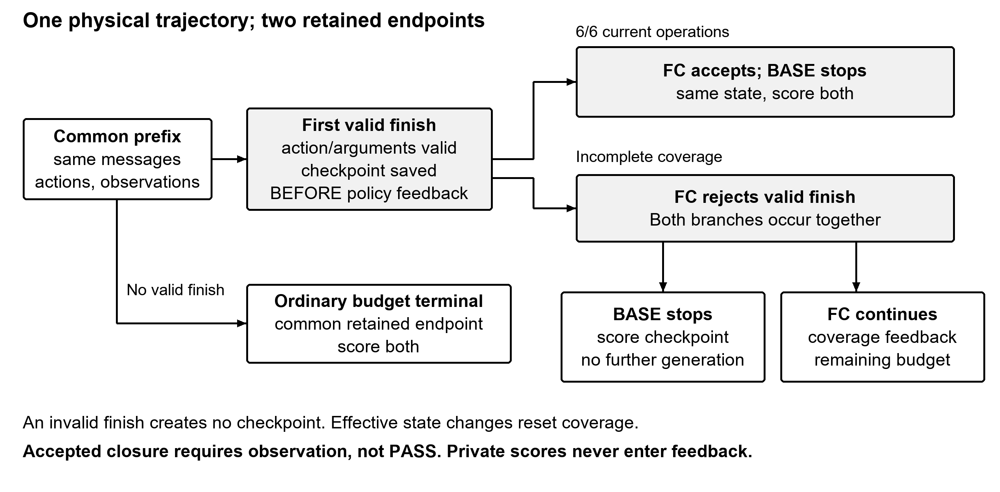

# SourceEnv: Separating Source and Environment Faults in Agentic CLI Repair

A resource with separately available repair axes; observed model repairs used source edits.

## Abstract

Repair outcomes can hide intervention choice, lost working behavior and closure with observed failures. SourceEnv integrates eight damaged fixtures and two healthy controls from a synthetic CLI family, a six-operation contract, a runtime-hidden oracle, pinned dependency profiles, a sandboxed harness, metrics, and scripted reference/no-op controls reproduced on fresh Debian. Coverage-gated closure (FC) is paired with a BASE endpoint at the first valid finish in the same execution prefix, without additional BASE generations. FC requires complete current-state observation, not correctness. In a predeclared single-seed run on author-visible fixtures, quantized Gemma 4 E4B repaired 3/8 damaged fixtures under FC and 2/8 under BASE; E2B repaired 2/8 in both arms. Both preserved 2/2 healthy controls. Under a prompt beginning “Repair app.py” and subsequently permitting either axis, every repair used source edits; neither configuration effectively changed profiles. One of sixteen damaged pairs was discordant. These descriptive results establish neither model superiority nor an isolated gate effect.

## 1 Introduction

Execution-based repair scores can hide three things: whether an agent intervened on source or dependencies, whether it lost behavior that already worked, and whether it closed with a failure visible in its observations.

The Gemma 4 competition organizer declares baseline-failure and reference-success checks during curation [1]. This is a declared procedure, not a guarantee across local configurations: published reference/empty audits obtain different validity sets [2, 3].

SourceEnv contains eight damaged fixtures plus two healthy controls, ten total. Its four contributions are an integrated CLI resource; a harness with a derived comparison endpoint; metrics separating interventions, preservation and observed failures; and a predeclared descriptive characterization accompanied by development lessons. The fixtures are synthetic and author-visible. This resource supports inspectable experiments, not broad capability rankings.

## 2 Related work

SWE-bench evaluates repository repair by execution, and its grading separates fail-to-pass from pass-to-pass checks [4, 5]. Repair overfitting and lost behavior precede LLM agents [6]. EnvBench and CI-Repair-Bench evaluate environment setup or code/configuration failures [7, 8].

Du et al. distinguish code/environment crash causes and manually assess proposed repairs [14]. DEPBENCH evaluates source repair while preserving dependency upgrades [15]. RepoRescue separates source-only audits, runtime blockers and realistic-use validation after PASS [17]. These precedents limit broad novelty claims about environment-aware repair and evaluation.

Dubey uses required-call coverage and shared checkpoints with fresh repair generations [9]. AgentTether combines diagnosis and guided re-execution, including text-acceptance hooks [10]. Advani studies false success with explicit success signals [16]; our public-failure closure metric requires no success claim. SourceEnv's contribution is the integrated auditable resource, not priority for these ideas or derived checkpoints.

M01 v6 labels 70/129 tasks valid in its Python 3.12 configuration, 48/129 in 3.13, with 47 shared IDs. Packages and wheels also differ. Its writeup is `paper.md` inside v6, with unconfirmed editorial version [2, 11]. M02 v8 publishes `sound=1` for 114/129; four flags alone yield 117, with three explicit empty-control timeout exclusions [3]. These audits share a corpus but differ in configuration/rules; neither isolated Python causality nor independent replication is established. Supplement S6 retains identifiers and criteria.

## 3 Resource

Fixtures combine initial source, dependency state and a contract over two commands, implicit help, group help and both command helps. Commands require rc 0, empty stderr and one JSON object with specified keys/values: balance/entries and credits/debits, except SC-SORT's ordered/maximum. Explicit help requires rc 0 and command information on stdout; implicit help permits rc 0 or 2. Each prompt announces the scored requirements. The oracle is hidden from the agent at runtime and included in the resource.

The frozen [task text](../SourceEnv/source/public_contract.py) begins “Repair app.py” and later says “You may edit source or choose an allowed profile; no particular repair or profile is required.”

| Fixture | Intervention surface | Mechanism |
| --- | --- | --- |
| SC-BALANCE | Source/commands | Debit sign lost in aggregation |
| SC-SORT | Source/commands | Numeric text sorted lexicographically |
| SH-FLAG | Source/help | Only `-h` registered; `--help` absent |
| SH-FORMAT | Source/help | Group formatter suppresses command information |
| EC-MISSING | Environment/commands | Typer missing at startup |
| EC-SYMBOL | Environment/commands | Click lacks command-path `NoArgsIsHelpError` |
| EH-API | Environment/help | Typer/Click help-signature mismatch |
| EH-RENDERER | Environment/help | Rich missing at deferred help import |
| H-RC0 | Healthy | Valid implicit help, rc 0 |
| H-RC2 | Healthy | Valid implicit help, rc 2 |

Table 1. Synthetic fixtures. Surfaces overlap—EC-MISSING also breaks help—so this is not an isolated factorial.

Eight scripted references pass in both arms; eight noops fail. All four environment references use `apply_profile("typer0160_click820")`; source workarounds are also permitted. Both scripted drivers, `reproduce.py` and `run_agent.py` with its scripted backend, reproduced these controls on fresh Debian. This establishes reachable repairs, not model capability.

The [extension guide](../SourceEnv/FIXTURES.md) and external validator document fixture expectations, controls and coupled components requiring adaptation; arbitrary families are not automatically supported.

## 4 Harness

The common prefix is the single sequence of messages, actions and observations shared by both arms before their stopping rules diverge. Observed state means completed captures for the current source/environment combination. The first valid finish passes action and argument validation, independently of FC acceptance.

Native tools are `list_files`, `read_file`, `write_file`, `run_app`, `apply_profile` and `finish`, with one call per turn. Non-empty text without tools is a finish summary subject to validation; empty, malformed or over-limit responses receive explanatory invalid-action feedback.

FC accepts valid closure only after completed captures of all six operations in the current epoch. Epoch identity combines source bytes and installed environment identity. Effective changes reset coverage; noops do not. Capture timeout/error does not cover an operation. Observing failure still counts as observation; accepted closure need not PASS.

BASE uses the same messages, tools, invalid-action handling and budgets until the first valid finish. The harness checkpoints before policy feedback. On FC rejection, BASE ends there while FC receives missing-operation/reset feedback and continues; on acceptance, the terminal is shared. Invalid finishes create no checkpoint. Without valid finish, ordinary budget termination gives a common scored endpoint. BASE requires no additional generation and retains its own coverage, actions and costs. Arms are independently available when their retained states and scores remain valid.

Figure 1. A valid finish can be rejected. The checkpoint precedes FC feedback; rejection jointly stops BASE and continues FC.

Applications and scorer use Debian/Bubblewrap, readonly source/environment, no network and fresh HOME/tmp/cache per invocation. Only dispatcher tools edit/install. `run_app` feedback is a capture, not a task verdict, and omits public `ok`; other tools retain operational states. `apply_profile` reports versions and identity-based `changed`. Endpoint scoring precedes cleanup; private verdicts never enter feedback.

## 5 Metrics and predeclaration

Repair is terminal PASS among available damaged arms; preservation is PASS among available healthy arms. Loss counts initially passing checks that fail at an endpoint. Requests, effective changes, noops and rejected/unknown effects are separated by axis. Coverage counts current-epoch completed operations out of six. A public-failure closure is a valid policy finish with a current contract failure established from delivered bytes; later correct observations replace failures, effective changes obsolete them, and truncation can make them unknown. Visibility does not prove understanding.

Bifurcation means first valid finish rejected; discordance means different endpoints in a complete damaged pair. Incomplete pairs are reported without imputation. Redundancy, identical-action streaks, stagnation, health, context and physical/partial costs are retained in Supplement S2–S5. Repeated finish ratios and shared arms are not independent probability estimates.

Before R3, freeze `ddd3a67d` identities were recorded in commit `af16d2f`. The timestamp is GitHub Actions server `created_at`, 2026-10-12T01:11:13Z, not the commit date. The private receipt verifies hashes; evidence is available to authors/on request, not publicly.

Per configuration: P1 predicts zero effective profile changes in four environment fixtures, following zero effective changes during development; P2 at least one bifurcation among ten, a weak exposure threshold; P3 agreement in all complete damaged pairs, evaluable with at least 6/8 complete. Completeness is not statistical power; compatibility is not confirmation.

## 6 Setup

C3 (primary) uses Gemma 4 E4B QAT q4_0; C1 (contrast), E2B Q4_0. Sampling follows the cards: temperature 1.0, top_k 64, top_p .95 [12, 13]. Seed 0, reasoning OFF, caching and 32,768 context are study choices. Reasoning is not reinjected; C3 nevertheless emitted 1,026 reasoning tokens, included in generated totals.

Per episode: 20 actions, 12 application requests, 3 profile requests, 2,048 tokens/reply and 8,192 total. Invalids, rejected finishes and parsed noop/invalid profiles consume applicable budgets; the fourth profile request stops without installing. Budget/context stops retain scored endpoints; watchdogs censor, infrastructure losses remain unavailable.

Each configuration ran ten fixtures in fixed interleaved order, C3 first then C1, without preflights, retries, replacements or independent BASE generation. R3 used Debian 13.7, Python 3.13.5 and Bubblewrap 0.12.0; llama.cpp b11429/commit d8123504 ran on Windows CPU, six threads, Ryzen 7 5800U/about 16GB RAM. The ten wheels, three selectable profiles, GGUF hashes, C1 alias and historical clean Linux check are detailed in Supplement S7. Development and clean-check results are distinct from R3.

## 7 Results

All forty arms were available; each configuration had eight complete damaged pairs and ten bifurcations, without censoring or infrastructure failure.

| Closure pattern | C3 | C1 |
| --- | --- | --- |
| **FC accepted with public failure / accepted** | **5/10** | **4/7** |
| BASE zero current coverage / endpoints | 6/10 | 4/10 |
| BASE zero coverage with prior effective change / endpoints | 4/10 | 4/10 |

Table 2. [Closure patterns](evidence/closure_patterns.json), including healthy fixtures. Zero coverage means no completed captures of the current state, not zero execution requests. Changes use each BASE prefix; denominators are not pooled.

| Configuration/arm | Repair | Preserve | Median coverage | Source requests/effective/noops | Public-failure finishes/valid |
| --- | --- | --- | --- | --- | --- |
| C3 FC | 3/8 | 2/2 | 6/6 | 15/10/5 | 7/24 |
| C3 BASE | 2/8 | 2/2 | 0/6 | 14/9/5 | 1/10 |
| C1 FC | 2/8 | 2/2 | 6/6 | 15/9/6 | 11/51 |
| C1 BASE | 2/8 | 2/2 | 2/6 | 11/7/4 | 0/10 |

Table 3. Coverage, requests and finishes span all ten fixtures, including healthy controls and budget terminals. BASE uses its checkpoint. Repair/preservation have separate denominators; repeated finish ratios reflect unequal exposure, not independent probabilities.

C3 made two physical profile requests, SH-FLAG and SC-SORT, both noops also present in BASE; C1 made none. Neither requested profiles in the four environment fixtures. Under the frozen source-first wording, all repairs used permitted source edits. P1/P2 were compatible in both configurations; P3 was refuted in C3 and compatible in C1. Only C3/EH-RENDERER was discordant: FC repaired source after rejection, BASE failed—one of sixteen damaged pairs.

C3 accepted ten closures and rejected fourteen; C1 accepted seven, rejected forty-four and had three budget terminals (two action, one application). Median coverage across ten fixtures was BASE 0/6 to FC 6/6 for C3 and BASE 2/6 to FC 6/6 for C1. Full coverage constrains accepted FC closure, not every terminal. These describe exposure to the bundled rejection/feedback/continuation, not isolated capability effects.

BASE accepted closures had public failures in C3 1/10 and C1 0/10; rejected FC requests had C3 2/14 and C1 7/44. In C3/EH-API, the summary treated allowed mentions of TypeError as permission for broken help (Excerpt E1). Acceptance certified observation, not correctness.

Three of four physical healthy episodes effectively edited source; their retained endpoints all remained PASS. C3 lost no initially passing check. C1/SC-BALANCE lost five at BASE; FC restored them, but `first_command` failed at both endpoints, leaving both FAIL. Effective edits and recovery of lost checks need not constitute repair.

Invalid responses were C3 3/119 and C1 1/159, all SUMMARY_LIMIT. Responses without tools include valid finish requests as well as invalids; Supplement S5 preserves the complete 16/25 breakdown and development comparison.

Physical costs: C3 119 calls, 26,277 tokens, 253 applications, 1.38 hours; C1 159, 24,752, 263, 0.76. BASE prefix costs are not added again.

## 8 Lessons

Development motivates accepting native text closure with validation and explaining invalids and coverage resets. The observations do not isolate interface effects.

Distinguish tool execution, state change and contract compliance. Only `run_app` suppresses public `ok`; operational states remain in `apply_profile` and other tools. E3 reports `ok:true, changed:false`: successful installation handling without state modification or demonstrated repair. Capture completion likewise does not mean application success. Explicit `changed` clarifies noops; it cannot certify PASS.

The EH-API tolerance misreading motivates clearer contract wording. Health should accompany trajectory metrics, while retrospective lessons remain separate from prospective results.

## 9 Limitations

Ten synthetic fixtures from one CLI family, overlapping surfaces and one seed provide no representative sample or variance estimate. There is no held-out set: authors saw fixtures and v05 was used in development before R3. Model configurations differ in size and quantization, supporting neither superiority nor isolated explanations. FC combines rejection, feedback and continued action; shared-prefix arms are not independent episodes. Analysis is descriptive, without significance tests.

The initial “Repair app.py” framing, despite later permission for either axis, may influence axis choice and edits to healthy fixtures. Its causal effect was not tested; absent profile changes do not establish intrinsic inability to repair environments.

Public failure means evidence was delivered, not understood. Results depend on contract wording, including TypeError tolerance. Policy prose says implicit help has no traceback although the oracle does not check this. Frozen bytes remain unchanged; Supplement S2 retains the erratum and endpoint-capture audit.

Portability was checked on fresh Debian CPU; R3's server was Windows-hosted, the clean server Linux-built. Other distributions, GPUs and hosted endpoints remain unverified; approximate accounting was tested only with scripts. The predeclaration seal remains private and publicly unverifiable. Public aggregates cannot reconstruct withheld conversations or independently verify every trajectory metric.

## 10 Conclusion

SourceEnv combines independently available repair axes, scripted solvability controls and auditable closure metrics. R3 characterizes behavior under its frozen “Repair app.py” framing: repairs used source edits, complete-coverage closure coexisted with failure, and one of sixteen damaged pairs differed. FC restored five lost checks without repairing SC-BALANCE. These descriptive distinctions separate resource validity from agent performance. Extension documentation supports future fixtures and evaluations; additional families require adapting and versioning the coupled contract, oracle and harness components.

## 11 Availability

Release candidate `1.0.0-rc3` is prepared for review, not published. Project-authored material is offered under MIT OR Apache-2.0; third-party terms remain applicable. Supplement S8 separates byte/offline analysis, scripted controls, future agent evaluation and limited-access historical evidence. The [checksum receipt](../release-info/RELEASE_CHECKSUMS.json) identifies the archive; the [documentary addendum](DOCUMENTARY_ADDENDUM.md) links unchanged components to rc2 checks. The rc3 ZIP was not executed. Public URL and persistent identifier remain pending. Private conversations, credentials and model binaries are excluded.

## References

1. Google / Kaggle (2026). [Gemma 4 Developer Agent Competition: Data](https://www.kaggle.com/competitions/gemma-4-developer-agent/data). Official curation description, verified 2026-10-14; earlier Input Data provenance retained.

2. Veerakrishna (2026). [Gemma 4 SWE Agent Benchmark Audit](https://www.kaggle.com/datasets/veerukhannan/gemma4-swe-benchmark-audit?datasetVersionNumber=6). Dataset v6.

3. Dmitry Gluzdov (2026). [Gemma 4 Task Soundness and Local Results](https://www.kaggle.com/datasets/dmitriigluzdov/gemma-4-task-soundness-and-local-results?datasetVersionNumber=8). Dataset v8.

4. Carlos E. Jimenez et al. (2024). [SWE-bench: Can Language Models Resolve Real-World GitHub Issues?](https://arxiv.org/abs/2310.06770v3). 2310.06770v3.

5. SWE-bench contributors (2026). [SWE-bench evaluation harness: swebench/harness/grading.py](https://github.com/SWE-bench/SWE-bench/blob/ca6e4e0d252f32f8762625b73575d5dee49d0a5a/swebench/harness/grading.py). Commit ca6e4e0d252f32f8762625b73575d5dee49d0a5a.

6. Edward K. Smith; Earl T. Barr; Claire Le Goues; Yuriy Brun (2015). [Is the Cure Worse Than the Disease? Overfitting in Automated Program Repair](https://people.cs.umass.edu/~brun/pubs/pubs/Smith15fse.pdf). ESEC/FSE 2015 proceedings, pp. 532-543.

7. Aleksandra Eliseeva et al. (2025). [EnvBench: A Benchmark for Automated Environment Setup](https://arxiv.org/abs/2503.14443v1). 2503.14443v1.

8. Rabeya Khatun Muna; Md Nakhla Rafi; Tse-Hsun (Peter) Chen (2026). [CI-Repair-Bench: A Repository-Aware Benchmark for Automated Patch Validation via CI Workflows](https://arxiv.org/abs/2604.27148v2). 2604.27148v2.

9. Sunny Dubey (2026). [Real-Time Detection and Repair of LLM Agent Failures](https://arxiv.org/abs/2608.02464v1). 2608.02464v1.

10. Chenyu Zhao et al. (2026). [AgentTether: Graph-Guided Diagnosis and Runtime Intervention for Reliable LLM Agent Operation](https://arxiv.org/abs/2607.06273v1). 2607.06273v1.

11. No byline declared (consulted 2026-10-13). [What the Graph Sees and What the Grader Measures](https://www.kaggle.com/datasets/veerukhannan/gemma4-swe-benchmark-audit?datasetVersionNumber=6). paper.md in dataset v6; editorial version unconfirmed.

12. Google DeepMind (consulted 2026-10-13). [google/gemma-4-E4B-it](https://huggingface.co/google/gemma-4-E4B-it/blob/ee0ef6023621cff504d758262d4e04895a5af4a2/README.md). Card revision ee0ef6023621cff504d758262d4e04895a5af4a2.

13. Google DeepMind (consulted 2026-10-13). [google/gemma-4-E2B-it](https://huggingface.co/google/gemma-4-E2B-it/blob/3e22461f65e89153144f8adb70e3b8c2cc9845a7/README.md). Card revision 3e22461f65e89153144f8adb70e3b8c2cc9845a7.

14. Xueying Du et al. (2025). [Exploring Large Language Models in Resolving Environment-Related Crash Bugs: Localizing and Repairing](https://arxiv.org/abs/2312.10448v2). 2312.10448v2.

15. Zijian Luo et al. (2026). [Update from Hell: Can Coding Agents Survive Hidden Breakage in Dependency Upgrades?](https://arxiv.org/abs/2608.30300v1). 2608.30300v1.

16. Laksh Advani (2026). [From Confident Closing to Silent Failure: Characterizing False Success in LLM Agents](https://arxiv.org/abs/2606.09863v1). 2606.09863v1.

17. Zhihao Lin et al. (2026). [RepoRescue: An Empirical Study of LLM Agents on Whole-Repository Compatibility Rescue](https://arxiv.org/abs/2607.01213v1). 2607.01213v1.
